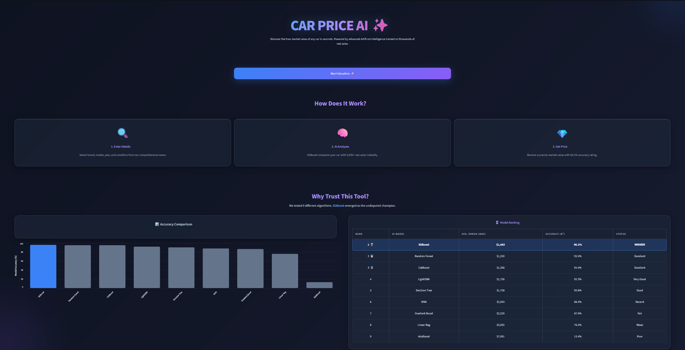
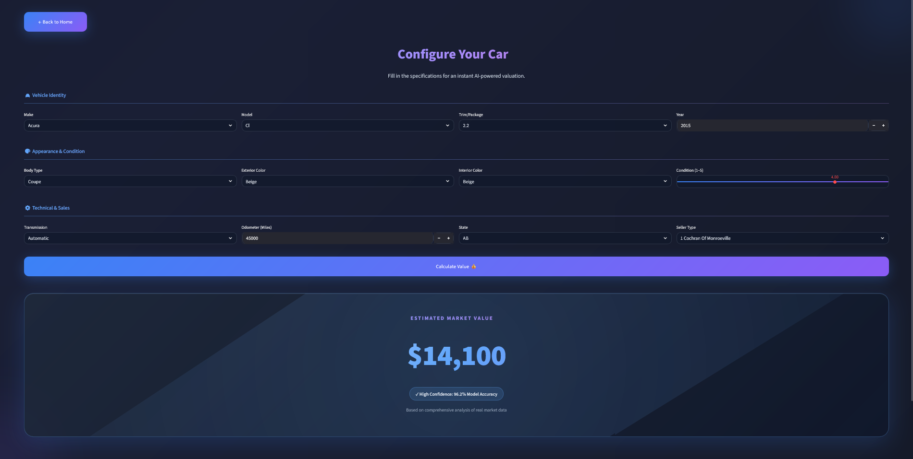

# 🚗 Used Car Price Prediction App

A machine learning-powered web application that predicts the market value of used cars in real time. Built with a clean Streamlit interface, it delivers instant price estimates based on vehicle specifications.


## ✨ Features

### 🤖 High-Accuracy ML Model
- **XGBoost** — Optimized gradient boosting algorithm for precise predictions
- **Scikit-learn Pipeline** — Clean preprocessing and encoding integrated into the model
- **Pre-trained & Ready** — Load `.joblib` model files instantly, no retraining needed

### 🎨 Interactive User Interface
- **Streamlit UI** — Modern, responsive, and intuitive web interface
- **Real-Time Results** — Instant price estimate on every input change
- **Rich Visualizations** — Charts and analytics powered by Matplotlib & Altair

### 📊 Comprehensive Feature Coverage
- **Make & Model** — Wide range of vehicle brands and models supported
- **Year & Mileage** — Core depreciation factors included
- **Transmission & Condition** — Full vehicle specification inputs

### 🛠️ Full Data Science Lifecycle
- **Exploratory Data Analysis** — Documented in `CARS.ipynb`
- **Feature Engineering** — Custom transformations for improved model performance
- **Model Optimization** — Hyperparameter tuning and cross-validation

## 📈 Model Performance

Eight algorithms, one shared preprocessing pipeline, one 80/20 split on **558,811
real auction sales**. A ninth, KNN, is named below the table rather than shown in
it, with the reason. Reproduce the whole comparison with:

```bash
python benchmark.py --data files/car_prices.csv --target sellingprice --drop mmr --cv 5
```

| Model | R² (test) | MAE | RMSE | 5-fold CV R² |
| --- | ---: | ---: | ---: | ---: |
| **XGBoost** | **0.9514** | **$1,262** | 2,144 | 0.9462 ± 0.0044 |
| Random Forest | 0.9479 | $1,289 | 2,218 | 0.9437 ± 0.0030 |
| LightGBM | 0.9387 | $1,495 | 2,407 | 0.9354 ± 0.0028 |
| HistGradientBoosting | 0.9339 | $1,515 | 2,499 | 0.9288 ± 0.0038 |
| CatBoost | 0.9147 | $1,747 | 2,839 | 0.9130 ± 0.0024 |
| Decision Tree | 0.9101 | $1,796 | 2,914 | 0.9070 ± 0.0030 |
| Linear Regression | 0.7805 | $3,037 | 4,555 | 0.7801 ± 0.0031 |
| AdaBoost | 0.0403 | $8,347 | 9,523 | 0.0124 ± 0.0690 |

Cross-validated scores track the held-out scores within half a point throughout,
so the ranking is not an artefact of one lucky split. KNN is excluded at this
size: its prediction cost grows with the product of train and test rows, which
is a property of the algorithm rather than a setting to tune. Run with
`--max-rows 50000` to include it.

### On the `mmr` column

The raw data carries `mmr`, the Manheim Market Report — a published wholesale
appraisal of the same vehicle. It is dropped before training, and it is worth
saying why: copying it verbatim as the prediction, with no model at all, scores
**R² 0.968 / MAE $1,087**, which beats every model in the table above. Any
benchmark that leaves it in is measuring the appraisal rather than the model.
The numbers here are what the model learns from the car's own attributes.

## 📸 Screenshots

### 🏠 Main Interface


### 📊 Prediction Result


## 🚀 Quick Start

1. **Clone the repository:**
   ```bash
   git clone https://github.com/Vugar-Mirzoyev/Car_Price_Prediction.git
   cd Car_Price_Prediction
   ```

2. **Install dependencies:**
   ```bash
   python -m pip install -r requirements.txt
   ```
   > **Note:** The `car_prices.csv` dataset is excluded from the repository due to size constraints. The application runs using the pre-trained `.joblib` model files.

3. **Run the application:**
   ```bash
   streamlit run app.py
   ```

4. Open **http://localhost:8501** in your browser and start predicting!

## 🔒 Privacy & Data

This application runs **entirely on your local machine**:

- ✅ No user data is collected or transmitted
- ✅ All predictions are computed locally
- ✅ Pre-trained model files included — no external API calls required
- ✅ Safe to run in offline environments

## 🛠️ Tech Stack

| Layer | Technology |
|---|---|
| Data Processing | Pandas, NumPy |
| Machine Learning | XGBoost, Scikit-learn |
| Interface | Streamlit |
| Visualization | Matplotlib, Altair |
| Model Persistence | Joblib |

## 📁 Project Structure

```
Car_Price_Prediction/
├── assets/             # Screenshots and visual assets
│   ├── main.png        # Main interface screenshot
│   └── prediction.png  # Prediction result screenshot
├── reports/
│   └── benchmark.md    # Generated model comparison
├── app.py              # Main Streamlit application
├── benchmark.py        # Regenerates the table above from raw data
├── CARS.ipynb          # EDA, feature engineering & model training
├── *.joblib            # Pre-trained model, scaler, and encoder files
└── requirements.txt    # Project dependencies
```

## 📜 License

This project is developed as a **Data Science portfolio project** and is open for learning and reference purposes.

---

*Built end-to-end as a portfolio project — from raw data to a deployed prediction interface.*
